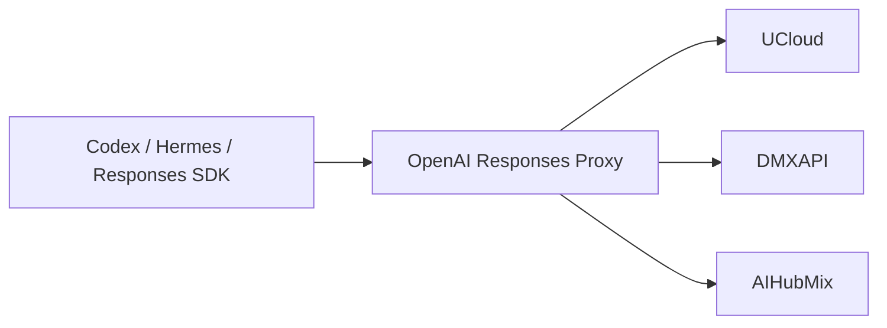

# OpenAI Responses Proxy

A local compatibility proxy for third-party OpenAI Responses APIs. It preserves
tool calls and readable Codex collaboration messages on qualified routes, adapts
streaming and replay for continued agent work, and owns its native service
lifecycle. Clients are qualified by actual Responses journeys and their native
runtime contract.

Licensed under [MIT](LICENSE). Forge coordinates and publication actors are
deployment context, not product identity.

It keeps Codex traffic provider-portable without editing conversation JSONL,
SQLite state, history, stored items, or model metadata.



## Product boundary

| Owner                  | Responsibility                                                                              |
| ---------------------- | ------------------------------------------------------------------------------------------- |
| Client                 | Conversations, tools, and per-conversation model selection                                  |
| Client control plane   | Credentials, provider selection, and client configuration                                   |
| OpenAI Responses Proxy | Responses normalization, replay portability, bounded recovery, and native service lifecycle |
| Provider               | Model execution, quotas, and upstream availability                                          |

The proxy does not configure or restart clients. A client control plane does
not manage the proxy process. Each product is installed and verified independently.
"OpenAI-compatible" alone is not an admission contract: Chat Completions,
Embeddings, and other OpenAI API families are outside this product's current
scope. Another Responses client is supported only after its request, replay,
streaming, error, and installed-client journeys pass the same conformance bar.

## Requirements

End users need only:

- the native release asset for their platform;
- the release trust anchor supplied by their organization;
- a third-party Responses endpoint configured by their client control plane.

Python, a source checkout, Git, and Forge credentials are not runtime
requirements.

Linux installation requires a reachable systemd user manager. A container without
that user session is not a supported service host. Installation reports
`native_service_unavailable` and rolls back its payload and command projection;
it does not start a session-only background process or require payload recovery.
Enable the user service environment before retrying. If the service manager is
unreachable, `status` reports the service as `unknown`, not proven absent.

Boot-time startup and continued operation after logout depend on the host's
[systemd user lingering policy](https://man.archlinux.org/man/loginctl.1.en).
The host administrator owns that user-wide policy. Proxy installs only its own
user service; it does not change lingering or request administrative credentials.

On macOS, the watchdog's launch agent admits the Aqua and Background sessions.
Installation requires a reachable user domain and does not create a login
session. With a GUI login, the watchdog is registered in that login's domain,
and launchd restores it at each later GUI login, including after a restart.
Without one, it runs in the user domain with a Background session, which launchd
does not restore after a restart; `status` then reports `stopped`, and `reload`
starts it again. An owned predecessor registration is replaced
only after the exact watchdog generation exits; unknown or competing
registrations are preserved.

## Install

```bash
openai-responses-proxy install \
  --asset "$HOME/Downloads/openai-responses-proxy-<version>-macos-arm64.tar.gz" \
  --trust-anchor ~/Downloads/openai-responses-proxy-allowed-signers
```

Replace `<version>` with the release version you downloaded. Download that
platform archive together with `SHA256SUMS` and `SHA256SUMS.sig` from either
official release plane. Keep the matching platform manifest—such as
`openai-responses-proxy-macos-arm64.manifest.json`—in the same directory.
`--asset` names the local archive. `--trust-anchor` names the SSH
`allowed_signers` file distributed by the organization or release owner through
a separate trusted channel. The installer requires the complete release set
and verifies the signed checksum before changing the service.

Use `--port` only when the default listener port `8792` conflicts with another
local service:

```bash
openai-responses-proxy install \
  --asset "$HOME/Downloads/openai-responses-proxy-<version>-macos-arm64.tar.gz" \
  --trust-anchor ~/Downloads/openai-responses-proxy-allowed-signers \
  --port 8801
```

Installation verifies the selected native bundle, commits it inside a rollback
transaction, and prewarms the exact installed executable before handoff. Use
`--timeout-seconds` only when a cold native executable needs more than the
default 30 seconds. Installation also projects `openai-responses-proxy` into the
current user's platform command directory as a native link. It does not create
a wrapper or edit a shell profile. The installed-state record retains that
exact path so status, rollback, and uninstall do not depend on a later shell's
environment. Installation never downloads dependencies or reads provider
credentials.

### Upgrade eligibility

In-place upgrade and rollback use immutable payload generations selected by
one durable selector. An installation without that selector is not an upgrade
predecessor. Use its existing uninstaller to remove the service and owned
payload, then install the verified release into a fresh target. Inspect any
reported residue before removing it; unknown files are never migration input.
Provider credentials and client configuration remain outside this lifecycle.

## Configure a client route

The listener exposes one provider-scoped namespace per admitted provider:

| Provider | Responses base URL                  |
| -------- | ----------------------------------- |
| DMXAPI   | `http://127.0.0.1:8792/dmxapi/v1`   |
| UCloud   | `http://127.0.0.1:8792/ucloud/v1`   |
| AIHubMix | `http://127.0.0.1:8792/aihubmix/v1` |

Configure these URLs in the client control plane, using that client's native
configuration grammar. The proxy has no package or configuration dependency on
that client.

For another Responses endpoint, select its origin once during installation:

```bash
openai-responses-proxy install \
  --asset "$HOME/Downloads/openai-responses-proxy-<version>-macos-arm64.tar.gz" \
  --trust-anchor ~/Downloads/openai-responses-proxy-allowed-signers \
  --upstream-base-url https://api.openai.com/v1
```

Point an ordinary Responses SDK at `http://127.0.0.1:8792/upstream/v1` and
supply the endpoint's credential through that client's existing credential
owner. The proxy persists only the selected secret-free URL in its native
runtime configuration. Released provider routes keep their own policies.

## Migrate from 4.x

Version 5 uses a new command, service, package, environment namespace, and
native data directory. Retain the verified 4.x asset and its original external
trust anchor outside the installed directory.

Migrate at an idle boundary, when no client depends on the old listener.
Removal stops that listener without draining it: in-flight Responses are
interrupted, and new requests are refused until version 5 accepts them.
Draining the old listener does not create this boundary; it rejects every new
request with a retryable local `503` until the drain ends. Before removal, use
each client's own control plane to route it around this listener, or stop the
client, then confirm that `codex-responses-proxy status --json` reports no
active Responses. Do not run the migration from a client whose model traffic
passes through this listener.

Then remove the old installation with `codex-responses-proxy uninstall --purge`
and install the verified 5.x asset using `openai-responses-proxy install`. Keep
the listener port so the original client URLs remain valid. After
`openai-responses-proxy status --json` reports an accepting listener, restore
those URLs through the same control planes. The proxy changes no client
configuration, credentials, or conversation history.

Cross-name recovery reverses those native operations: uninstall 5.x and
reinstall the retained signed 4.x asset with its original trust anchor. The
ordinary `rollback --to-release` command remains bound to one product's
retained generation chain. Published 4.x assets and their signing namespace
keep their original identities.

## Operate

```bash
# Human-readable state
openai-responses-proxy status

# Stable machine contract
openai-responses-proxy status --json

# Read-only diagnosis
openai-responses-proxy doctor

# Hand off and rebind native supervision; start a stopped installation
openai-responses-proxy reload

# Converge on the exact active release or verified retained predecessor
openai-responses-proxy rollback --to-release <exact-version>

# Resolve an interrupted payload transaction; idle recovery is a successful no-op
openai-responses-proxy recover

# Remove native supervision; preserve the verified payload
openai-responses-proxy uninstall

# Remove supervision and manifest-owned payload files
openai-responses-proxy uninstall --purge
```

Lifecycle JSON uses one explicit `state` discriminator. Every successful result
also carries `next`, the one safe follow-up command that the human output shows
under Next, or `null` when nothing follows; a failure carries it as `error.next`.
`install` returns
`unchanged` when the signed artifact exactly matches the healthy active
installation; it neither replaces files nor restarts the listener. The same
version with different artifact bytes is not the same installation. When that
artifact's verified installation lacks native supervision, for example after
`uninstall` preserved the payload, `install` restores the command and native
supervision without replacing payload files and returns `installed` after the
serving listener is proved.
`status` reports `stopped` when a verified installation keeps its owned
supervisor declaration but neither the supervisor nor a listener runs, for
example after a restart, and names `reload` as the next action. `reload`
returns `reloaded` after a same-payload handoff that also binds native
supervision to the lifecycle control executable, as an upgrade does, and
`started` after it binds that stopped installation's native supervisor and
proves the serving listener. It refuses before any change when the owned
supervisor declaration does not bind that executable. `status` reports the
service as `outdated` when a running supervisor's owned definition differs from
the installed release's rendering, for example a launch agent that an older
installer wrote; Windows compares only the scheduled task's action, because Task
Scheduler normalizes the rest of an exported task. With a serving listener,
`doctor` names `reload` when native supervision is declared but not running or
outdated, `install --help` when it is absent, and `status --json` when it is
unknown. Without a verified runtime, `doctor` names `reload` only for a
`stopped` installation, `install --help` when native supervision is absent, and
otherwise `status --json`.
`rollback` returns
`unchanged` when the requested release is already the proven active
installation, `unavailable` when no verified predecessor exists, and
`rolled_back` only after the requested predecessor is the proven accepting
installation. It refuses before any change when no runtime answers on the
installed port; start a `stopped` installation with `reload` first. `recover` returns
`not_required` when no transaction exists, `closed` when an unmutated prepared
transaction is discarded, `finalized` when the committed candidate is already
the proven live installation, `rolled_back` when the exact prior state is
restored, and `purged` when interrupted removal finishes. `uninstall` and
`uninstall --purge` return `not_installed` with exit
status zero only when no owned service, listener, command, payload, or
transaction exists. Existing but unverifiable state is never treated as
absence and remains unchanged for diagnosis.

Before deleting payload files, purge records their exact paths and digests in
the existing transaction journal. An interrupted purge resumes through
`recover` or `uninstall --purge`; it does not depend on files already removed.
Unknown content and changed replacements are preserved and reported, including
empty directories. Remove or relocate that content deliberately, then retry.
During recovery, use a separate verified release executable if the installed
command has already been removed.

A successful upgrade retains exactly one predecessor in the immutable
generation store. One atomic selector under the stable control root is the
sole authority for both the active generation and that predecessor; installed
state and the user command remain stable control surfaces outside either
generation. The selector chooses the serving payload; the user command stays
on the newest verified selected release, so an explicit serving rollback cannot
downgrade `status`, `doctor`, `recover`, `rollback`, or the next installer.
Native supervision remains bound to the serving generation. Finalization is
idempotent across interruption, and the
transaction owns temporary bootstrap evidence, selector reconciliation,
cleanup, and recovery until it closes. `status` therefore reports rollback as
`deferred` while a transaction is active instead of treating its intermediate
state as an independent rollback authority. Upgrade and rollback use the same
capability-qualified handoff. A runtime that advertises
`admission-preserving-handoff` transfers listener ownership while continuing to
admit new requests and lets already accepted requests finish. The previous
listener keeps serving them until they end or reach the configured upstream
timeout, at most 900 seconds, and the command returns after it exits. Draining is used
only for the bounded native-generation replacement of an older runtime that
cannot preserve admission.

Expected failures are concise and actionable. Human mode does not emit a
traceback, warning dump, serialized object, credential, request body, or private
path. Automation should use `--json` where the command supports it.

## Compatibility behavior

Every request is projected to a provider-portable Responses grammar before it
leaves the loopback listener.

| Concern                     | Behavior                                                                                         |
| --------------------------- | ------------------------------------------------------------------------------------------------ |
| Storage                     | Sends `store=false`; continuity comes from replayed dialogue and complete tool relationships     |
| Provider IDs                | Removes response, conversation, cache, stored-item, and provider-issued item bindings            |
| Encrypted replay            | Removes reasoning history; preserves required native agent payloads without claiming decryption  |
| Agent delivery              | A selected plaintext route generates readable delegation and restores the native delivery marker |
| Tool replay                 | Keeps complete function/custom-tool call pairs; rejects unsafe structure locally                 |
| Empty upstream response     | Returns a retryable local `503` instead of committing false success                              |
| DMXAPI `477 empty_response` | Retries the already-projected bytes once                                                         |
| Upstream `429`              | Relays the first response and applies a provider-scoped bounded cooldown                         |
| Exhausted upstream `503`    | Relays the original error; subsequent turns briefly cool only that provider before probing again |
| `response_failed`           | Uses strictly shrinking, pair-safe recovery; one final dialogue-only attempt is bounded          |
| Invalid `input` union       | Uses one smaller current-dialogue fallback, then stops                                           |
| Exchange deadline           | Header acquisition, recovery waits, error/JSON reads and SSE reconnects share one total budget   |

The proxy never rewrites conversation storage to obtain portability.

An expired exchange returns `504 upstream_deadline_exceeded` before commitment.
Already-delivered SSE content is preserved; the connection closes without
replaying the request or inventing completion. Both JSON and HTTP error bodies
are limited to 8 MiB. A malformed or unreadable error body returns a structured
local failure rather than forwarding a partial upstream response.
HTTP headers and chunk framing cannot extend the budget by continually sending
small fragments. TCP connection setup, the TLS handshake and request writes use
only the remaining budget. System DNS resolution stays synchronous and a socket
timeout cannot cancel it; its wall-clock bound has not been qualified. The
upstream budget starts after local request projection; client-body reception
has its own finite budget.

The released UCloud route selects plaintext agent delivery. This requires a
Codex client with the native plaintext-message path, the `collaboration` tool
namespace, and a model catalog matching the conversation's agent version. The
client's own configuration owner selects those settings. The proxy aliases the
reserved namespace before generation, restores native call identities and the
empty encrypted-argument list, and refuses to relabel ciphertext as plaintext.
Existing encrypted messages remain subject to their original provider's
decryption support. An empty current-turn tool catalog remains an explicit
control, including during native compaction.

## Request boundary

Only these exact provider-scoped requests are admitted:

```text
POST /<provider>/v1/responses
GET  /<provider>/v1/models
```

Responses requests receive portable projection and bounded recovery. Model
catalog success and HTTP errors are relayed once without Responses-specific
transformations. Catalog headers, body reads and downstream writes share a
30-second deadline and an 8 MiB body limit, independent of inference. Expired
headers return HTTP 504 `catalog_deadline_exceeded`; a failure after commitment
keeps the admitted prefix and closes without replay or a successful terminator.
Local failures close the connection and allow one separate catalog-timeout
budget to deliver their bounded error, even when upstream time has expired.
Encoded path material, dot segments, duplicate separators, absolute targets,
fragments, and unrelated endpoints are rejected before remote I/O. Provider
origins come from the product manifest or the explicit installed upstream;
headers, bodies, and query parameters cannot select another host.

Each Responses body requires one ASCII decimal `Content-Length` and must
finish within 30 seconds without exceeding 64 MiB. The body deadline starts
after header parsing, does not renew with partial progress and is independent
of inference or streaming. Over-limit bodies receive HTTP 413; expired bodies
receive HTTP 408, both with `request_body_rejected` and a fixed reason before
upstream I/O. Rejection closes the connection without exposing body content.
Header-reception and downstream-write deadlines are not established by this
body-admission contract.

For a fresh installation, choose alternate budgets with
`OPENAI_RESPONSES_PROXY_REQUEST_BODY_MAX_BYTES` (4096–268435456 bytes) and
`OPENAI_RESPONSES_PROXY_REQUEST_BODY_TIMEOUT` (0.001–300 seconds) in the
installer's environment. Its native configuration owns the persisted values;
upgrades retain them instead of taking a later shell's environment. Older
configuration files receive these defaults without read-time mutation.

Catalog settings follow the same persisted ownership:
`OPENAI_RESPONSES_PROXY_CATALOG_TIMEOUT` (0.001–300 seconds) and
`OPENAI_RESPONSES_PROXY_CATALOG_MAX_BYTES` (4096–67108864 bytes). Catalog bounds
do not establish inbound header deadlines or synchronous DNS cancellation.

SSE limits each event and the held pre-content prelude to 64 MiB, independently
of stream duration or total delivered bytes. A fresh installation may select
`OPENAI_RESPONSES_PROXY_SSE_BUFFER_MAX_BYTES` (4096–268435456 bytes); upgrades
retain that value and older carriers receive the default without a read-time
rewrite. An exceeded budget returns `stream_buffer_limit` before commitment,
or closes an already committed response without replay or a successful
terminator. Valid events and live ciphertext keep their bytes.

## Runtime evidence

`status --json` reports secret-free local evidence:

- installed release, payload integrity, and command discoverability;
- native service and exact listener identity;
- transaction state;
- accepting and draining state;
- bounded reliability counters and classified failures.

It does not report prompts, tokens, headers, request bodies, upstream payloads,
or conversation content.

## Troubleshooting

| Symptom                            | First action                                   | Interpretation                                                                |
| ---------------------------------- | ---------------------------------------------- | ----------------------------------------------------------------------------- |
| Replay or encrypted-item rejection | `openai-responses-proxy doctor`                | Confirm local payload and listener integrity before changing the client route |
| Error after provider switch        | Check the client control plane                 | A direct provider URL bypasses proxy portability                              |
| Local `503`                        | `openai-responses-proxy status --json`         | Distinguish empty/truncated upstream output from local lifecycle failure      |
| Local or upstream `429`            | Inspect `Retry-After` and provider state       | Cooldown is provider-scoped; the proxy does not impose a global request queue |
| Route change not observed          | Reload the client through its normal lifecycle | The proxy does not restart or mutate clients                                  |

## Development

Development uses the repository-owned Python environments and locked supply
chain. These commands are DX, not product UX:

```bash
mise install --locked
mise run bootstrap
mise run check
```

The tasks in `.config/mise/config.toml` select the locked Python installation and this
worktree's `.venv`; Nox owns isolated `.nox/<session>` verification environments.
Use `mise run quick` while editing. `check` runs repository governance, strict
quality and Python 3.12 coverage, then Python 3.13 and 3.14 compatibility.
`mise run release` verifies a native release asset; `mise run native` also
exercises real host services and requires an authorized test host.

See [CONTRIBUTING](CONTRIBUTING.md) for source verification and release work.

## Documentation

Use the [documentation map](docs/README.md) for product journeys, architecture,
decisions, evidence, and release governance.

Licensed under the [MIT License](LICENSE).
