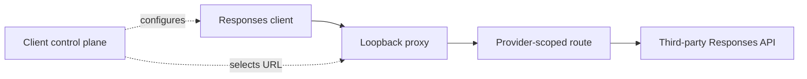
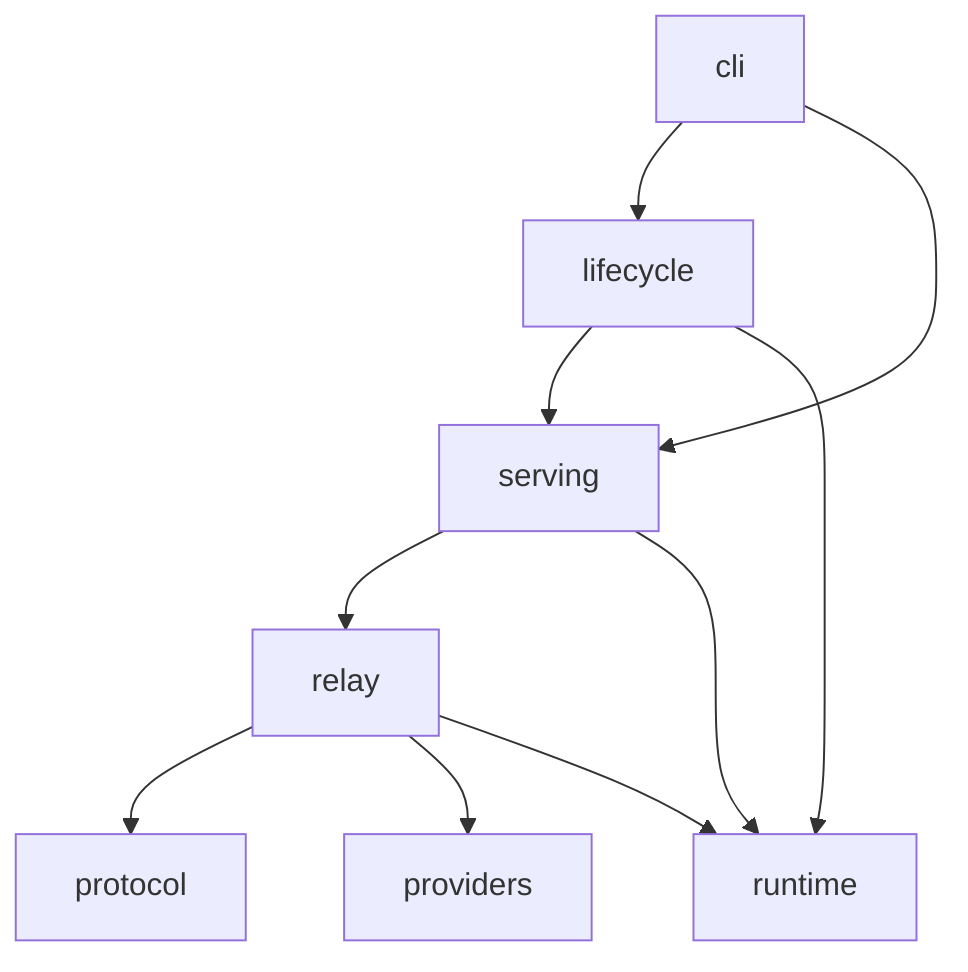
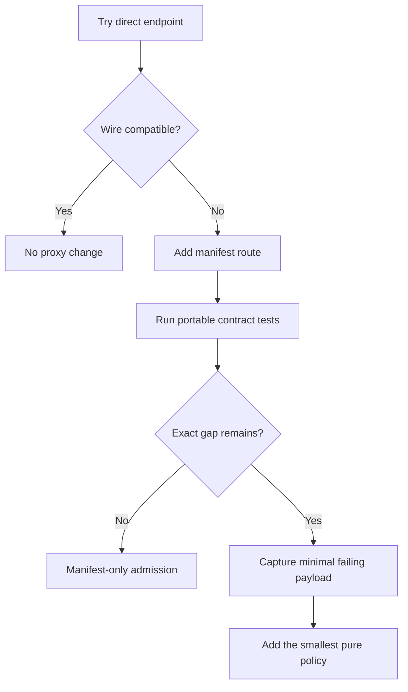
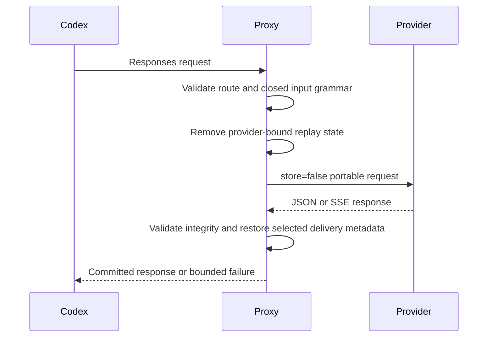
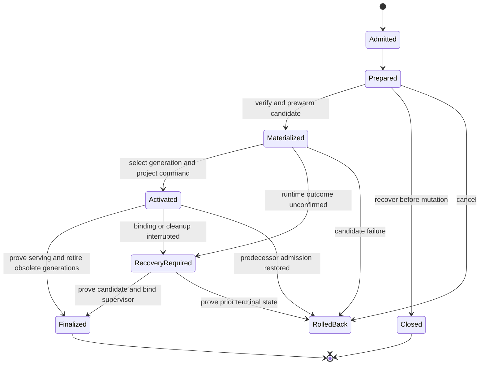

# Authority and Runtime Boundary

OpenAI Responses Proxy is a local Responses data plane. It normalizes outbound
traffic and owns its native service lifecycle. It does not own client state or
provider selection.

## Product position

The proxy is a narrow compatibility edge for proven Responses gaps. It is not
a general AI gateway, provider catalog, configuration switcher, billing plane,
or agent runtime. Direct provider access remains the default whenever the
client and provider already share a sound protocol.

Its value is the combination of a small authority surface and strong replay
semantics: provider selection stays in the client control plane, while the
proxy makes only the minimum transport changes needed for stateless,
provider-portable Responses traffic.

## Product graph



## Authority

| Owner                    | Authoritative state                                                    |
| ------------------------ | ---------------------------------------------------------------------- |
| Client                   | Conversations, tool state, JSONL, SQLite, stored items, model metadata |
| Client control plane     | Credentials, provider selection, and client endpoint configuration     |
| Proxy source and release | Provider manifest, protocol policy, native bundle, lifecycle contract  |
| Installed proxy          | Manifest-owned payload and native service projection                   |
| Provider                 | Model execution, quota, and upstream availability                      |
| GitLab / GitHub          | Independent CI, tag, Release, and asset records                        |

The proxy repairs compatibility only at the network edge. It never rewrites a
conversation or reads another product's configuration.

## Semantic packages

The product lives under [`src/openai_responses_proxy`](../../src/openai_responses_proxy/).
The [architecture policy](../../.config/checks/architecture/policy.toml) owns
admitted package boundaries and dependency directions; this view explains them.



| Package     | Owns                                                                            |
| ----------- | ------------------------------------------------------------------------------- |
| `cli`       | Public grammar, command composition, human/JSON selection                       |
| `lifecycle` | Artifact trust, payload transactions, installed settings and native supervision |
| `serving`   | Listener identity, health, structured logs, control and handoff protocol        |
| `relay`     | Request admission, upstream exchange, retries, cooldown, SSE and HTTP integrity |
| `protocol`  | Portable replay, tool relationships, delegation and live-response grammar       |
| `providers` | Manifest-defined routes and explicit wire policies                              |
| `runtime`   | Portable paths, validated process settings, environment and bounded I/O         |

The diagram shows principal dependencies, not every import. Protocol and
provider declarations do not perform lifecycle effects. Runtime primitives
serve the effectful domains without depending on them. Lifecycle owns the
installed configuration carrier; runtime validates its process-level projection.
Product-root modules own identity, errors and JSON value types rather than a
second domain registry.

Nested boundaries retain the same direction: lifecycle transactions own
admission, completion and restart recovery; deployment owns activation and
handoff; supervision owns native service and process control. Serving handoff
owns listener-transfer state, distinct from installation mutation. Protocol
replay owns portable items and relationships; protocol recovery owns permitted
request reduction, while relay owns deadlines and transport attempts. Provider
policies supply explicit wire differences selected by the manifest.

No package may infer provider behavior from a name when the manifest or explicit
policy contract owns it.

## Repository-only domains

[`tools`](../../tools/) composes development and delivery operations outside the
released runtime. Product code never imports it or the test tree. Tool domains
may consume product contracts and lower-level repository owners, but may not
form dependency cycles or import test fixtures.

| Domain        | Owns                                                           | Boundary                                               |
| ------------- | -------------------------------------------------------------- | ------------------------------------------------------ |
| `ci`          | CUE projection and hosted branch-proof evaluation              | Renders peer workflows; does not publish branches      |
| `forge`       | Runner admission and read-only exact-object parity             | Observes peers; ETHOS owns branch and tag writes       |
| `governance`  | Bounded reads of the native ETHOS command plane                | Consumes decisions without reconstructing policy       |
| `quality`     | Native check composition and repository-specific contracts     | Uses declared scopes and original tool reports         |
| `performance` | Reproducible latency and memory measurements and budget checks | Measures product behavior without provider latency     |
| `release`     | Metadata, trust, artifact construction and Release publication | Publishers consume an immutable pre-signed bundle      |
| `reliability` | Secret-free evaluation of installed status observations        | Reads supplied evidence; does not control the listener |

Release construction belongs to `release/artifact`; `release/publication`
composes publication and verification, with each Forge's read and write effects
in its own adapter. The shared Git environment module binds repository commands
without becoming another workflow controller. Tests follow these product and
tool boundaries; native distribution cases remain separate from source-only
contracts.

## Provider routing

The released manifest is the sole provider registry.

```text
/<provider>/v1/responses
/<provider>/v1/models
```

- Responses routes enter projection, recovery, cooldown, and integrity checks.
- Models routes are transparent authenticated GET relays.
- Unscoped, encoded, ambiguous, or unrelated paths fail before remote I/O.
- Headers, bodies, and query parameters cannot select an upstream host.
- Adding an ordinary provider changes one manifest table.
- One explicit ordinary upstream is selected through the existing native
  runtime carrier. It adds `/upstream/v1` without another catalog, credential
  owner, implicit fallback, or a provider-specific policy.

## Provider admission

Provider integration follows one ordered test:



- Native Responses that works directly needs no proxy change.
- A standard Bearer endpoint that needs only portable projection adds one
  manifest entry.
- A reproducible wire difference adds one narrow pure policy and its regression
  evidence.
- Request signing or another stateful authentication exchange requires a
  separate authentication boundary.
- A different invocation protocol requires an explicit protocol Adapter or
  product decision.

A provider name never creates behavior. The released manifest selects a route
and, when necessary, an explicitly declared policy. This keeps ordinary
Provider admission data-driven and makes a new policy pay for its permanent
maintenance cost with exact evidence.

AWS Bedrock illustrates the distinction. A Mantle endpoint that already speaks
OpenAI Responses can be admitted as an ordinary route. Native IAM/SigV4 or
Converse/InvokeModel would require explicit authentication and protocol work;
it must not be represented as a Bearer-compatible route.

## Responses projection

`relay/responses.py` admits HTTP framing before replay interpretation. One ASCII
decimal length and exactly that many bytes identify the body. Unsupported transfer
encodings, ambiguous lengths and truncated bodies receive a fixed local error
and close the connection before upstream I/O. The validated byte limit rejects
oversized bodies before reading; one monotonic body deadline bounds stalled or
trickled input without renewal. A valid body remains separate from the next
keep-alive request, and the original socket timeout is restored after admission.
`runtime/config.py` owns these limits independently of upstream inference.

The pipeline keeps transformation and resource ownership explicit:

| Stage                                 | Owner                                                         | Input and output                                                                           |
| ------------------------------------- | ------------------------------------------------------------- | ------------------------------------------------------------------------------------------ |
| Route and body admission              | `relay/responses.py`, `providers/registry.py`                 | HTTP request to one declared profile and bounded body, or a local failure                  |
| Replay projection                     | `protocol/replay/projection.py`                               | Body bytes to `ProjectionResult`, including portable bytes, metrics and dependencies       |
| Item and relationship validation      | `protocol/replay/items.py`, `protocol/replay/input.py`        | Ordered input to one policy disposition and retained dependency edges                      |
| Delegation selection                  | `protocol/agent_delivery.py`                                  | Portable bytes and delivery mode to `PreparedRequest`, binding response restoration        |
| Upstream exchange and recovery        | `relay/exchange.py`, `relay/upstream.py`                      | `Exchange` to `UpstreamResponse` or a terminal failure within the original deadline        |
| Live response validation and delivery | `protocol/response.py`, `relay/downstream.py`, `relay/sse.py` | Upstream bytes to validated JSON or events, then one committed response or bounded failure |

`relay/responses.py` checks cooldown and acquires admission before upstream I/O,
then releases the admission slot in `finally`. Each transport owner releases its
upstream response on completion or failure. Recovery consumes the projected bytes
and their dependencies; it cannot reinterpret replay or refund elapsed time.



The request projection removes response, conversation, cache, provider-issued
item, search, and encrypted-reasoning bindings. It retains portable dialogue
and complete tool relationships. Unknown or unsafe structures fail locally.

The item policy owns ordered tool relationships as well as item classification.
Projection, diagnostics, and recovery consume the same request-local relationship
state: one call identity, its declared output kind, and an initial paired result.
Later named results with distinct item identities become attributed delivery
messages in their original positions, not duplicate pairs or replacement results.
A repeated call cannot replace the original identity. Recovery checks the actual
retained sequence and declared dependencies through this owner, including pinned
earlier input, rather than validating a suffix or a matching ID alone. Pending
portable calls remain observable; a local-only
call may be removed only with its complete output relationship.

Input diagnostics report the request projection's rejection reason, not a
second content validator. An empty reason means the request is locally
projectable; it does not claim that an upstream Provider will accept it.
Categorical counts, shape hashes, and relationship flags describe the original
input without recording its values. They remain observations, not additional
admission rules.

Encrypted `agent_message` content is required control data, not disposable
reasoning history. Preserve its native envelope and exact ciphertext for the
selected upstream; never reduce a task to its visible routing header. The proxy
does not decrypt messages or promise that another provider can decrypt them.
An upstream `invalid_encrypted_content` response is relayed without replacing
the task body and classified as `provider_bound_encrypted_content` in secret-free
telemetry. This identifies the upstream refusal, not the origin of the ciphertext
or a safe migration target. Shrinking recovery is unavailable for a request
carrying a native agent message; it cannot discard the task and retry an empty
continuation.

The live-response boundary preserves encrypted control content needed for the
current turn. Empty, truncated, malformed, oversized, or non-terminal JSON success
bodies become a retryable local `503` before commitment. SSE validates each event
before delivery; a failure after commitment preserves emitted bytes and closes
without replay, a second HTTP status or fabricated completion.

`providers/manifest.toml` selects `agent_message_delivery` as `native` or
`plaintext` per route; omission selects native delivery. The plaintext protocol
adapter aliases the reserved collaboration namespace before generation and
removes the encrypted annotation only from `spawn_agent`, `send_message`, and
`followup_task` message schemas. Replayed calls and explicit tool choice use
the same alias. The response restores `collaboration` after complete readable
arguments arrive: function calls use `arguments` and the native empty
`encrypted_function_args` list; custom calls preserve `input` without function
metadata. Message text and call identities remain exact. Nonempty encrypted
metadata, function metadata on custom calls, cipher-shaped messages, and
conflicting aliases fail closed. Preserving a custom call's wire grammar does
not establish a client's native delivery support for that tool.

The signed client's native path requires the `collaboration` namespace and a
model catalog whose agent version matches the conversation. Those inputs belong
to its configuration owner. A stream's empty call start may precede arguments;
validation occurs before the completed message can be delivered. Existing
encrypted messages keep their envelope and ciphertext. Empty `additional_tools`
lists retain their explicit current-turn meaning during native compaction.

## Recovery ownership

| Condition                       | Bounded behavior                                                               |
| ------------------------------- | ------------------------------------------------------------------------------ |
| DMXAPI `477 empty_response`     | Retry the already-projected bytes once                                         |
| `response_failed`               | Strictly shrinking pair-safe attempts, then at most one dialogue-only attempt  |
| Invalid `input` union           | One smaller current-dialogue attempt                                           |
| Undecryptable agent content     | Relay the upstream rejection without replacing the task                        |
| Pre-content stream interruption | Retry only before substantive downstream commitment                            |
| `429`                           | Relay once; provider-scoped cooldown; no global queue                          |
| Exhausted upstream `503`        | Relay the original error; briefly cool only that provider before probing again |

Each recovery consumes the same provider-portable request owner. No recovery
path restores provider IDs, ciphertext, or an older request body.

Retries are bounded by the semantic failure class. The proxy does not provide
cross-provider fallback, a global work queue, or hidden model substitution.
Those behaviors would combine transport ownership with routing policy and make
provider switching less observable.

## Lifecycle transaction



Artifact admission verifies the release asset, complete bundle inventory, and
external trust anchor. The installer commits the verified projection, then
prewarms that exact executable and requests listener handoff while rollback
remains available. Only after the successor proves ownership of admission does
the transaction rebind native supervision to that generation and prove both
the configured and running executable identity. The handoff child owns listener
transfer and runtime identity; it does not mutate launchd, systemd, or Task
Scheduler state. A failed supervisor rebind preserves the transaction for
recovery; recovery cannot delete that authority until the terminal generation's
supervisor binding is proved.
The same transaction projects one native user-command link and records its
exact path in installed state. Rollback and uninstall therefore do not re-derive
ownership from a later shell environment. Installation finalizes only after one
listener proves the expected release, payload digest, manifest digest, receipt
digest, PID, and accepting state.

Finalization performs one idempotent selector transition. The stable control
root contains one atomic selector naming the active immutable generation and,
after an upgrade, its sole predecessor. Installed state and the user-command
projection remain stable control surfaces; they are not copied into a second
rollback store. The selector's active generation owns serving and native
supervision. The user command deterministically resolves to the newer verified
release among the two selected generations, preserving current lifecycle
control when serving rolls back. Future installation admission uses that same
control release as its replay and downgrade floor. A transaction may carry a
temporary snapshot only to bootstrap an older single-directory installation or
recover an interrupted transition.
The selector is committed before obsolete-generation cleanup, so interruption
leaves either the prior selection or a recoverable new selection. Until the
transaction closes, it alone owns recovery and rollback status.

Normal completion and interrupted recovery share one finalization owner for
installed state, predecessor retention, pruning, and journal removal. Each
transaction mutation must match its identity against the current journal;
an in-memory controller alone grants no write authority. Completion consumes
that authority: an old controller cannot overwrite or remove a later
transaction's journal. Once an outcome requires recovery, only runtime-aware
recovery may resolve it; ordinary rollback cannot guess whether the candidate
is already serving.

Generation, transaction-snapshot disposal, and uninstall purge share one
exact-file deletion owner.
The transaction journal captures candidate paths and digests before materialization
and verified retired-generation paths before cleanup. A new process resumes only
that inventory, even after the discarded manifest or executable is gone. Replaced
files and unlisted files, directories, or links are preserved; remaining unknown
content prevents cleanup from reporting success. A generation's directory name
alone never authorizes recursive deletion. The journal also records the command
snapshot's exact digest before writing it. Terminal cleanup removes only that
snapshot and its known empty container; replacements and unrelated transaction
content remain untouched and keep recovery authority available.

The release that first introduces this transition must drive its own one-time
upgrade from an older installed release: the predecessor cannot execute
finalization semantics that did not yet exist. This is an explicit bootstrap
at the installer boundary, not a second carrier schema or a runtime migration
path. Once established, the installed release owns adjacent upgrades normally.

Reload is a same-payload handoff that then binds native supervision to the
lifecycle control executable, as an upgrade's handoff does; when a verified
installation's supervisor is stopped and no runtime remains, reload binds that
supervisor and proves the serving listener instead. Upgrade is install. Installing
the signed artifact whose verified installation lacks native supervision
restores the command and that supervision without a payload transaction.
Rollback is a new reverse
transaction from the current successor to its sole retained predecessor.
Recover resumes or resolves an already active transaction; it is not a synonym
for rollback. Uninstall removes native supervision first, proves owned listener
exit, removes only the recorded command link while it still targets the
installed executable, then optionally removes only manifest-owned payload
files.

## Human and machine surfaces

The CLI projects one result model:

| Surface | Contract                                                                                 |
| ------- | ---------------------------------------------------------------------------------------- |
| Human   | Scannable lifecycle state and one safe next action                                       |
| JSON    | Stable, secret-free machine evidence                                                     |
| Logs    | Structured bounded events; no prompts, Tokens, headers, bodies, or raw upstream payloads |

Runtime evidence proves only the installed listener. It does not prove client
configuration, provider billing, or recovery of a historical conversation.
