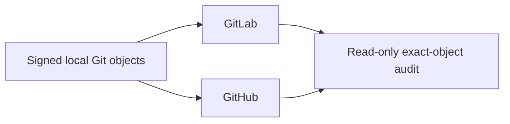

# Forge Operations

Local Git is the product-object authority. GitLab and GitHub are independent,
optional publication peers; neither is a mirror source for the other.

## Authority model



| Plane             | Owns                                                                                 |
| ----------------- | ------------------------------------------------------------------------------------ |
| Local             | Commit and tag objects, source proof, install, runtime proof                         |
| Native builders   | One admitted asset pair for each supported platform                                  |
| Product assembler | Complete platform inventory, one checksum manifest, one product signature            |
| GitLab            | Peer-local review and tag verification, transport authentication, Release projection |
| GitHub            | Peer-local review and tag verification, transport authentication, Release projection |
| Audit             | Read-only comparison after publication                                               |

The commit and annotated tag are signed once locally. The public signing key and
product email must be accepted by each selected Forge. SSH keys or tokens used to
push may differ per Forge; transport authentication never changes a Git object.
Each Forge supplies its own allowed-signers trust input. Product source contains
no personal key, private credential, local checkout path, or Forge token.

## Branches

ETHOS owns branch publication. [`.ethos/release.toml`](../../.ethos/release.toml)
declares the publication peers and the protected `main` and `dev` refs.
Accepted `dev`, release `main`, and `proposal/*` are the only branch
publication sources; `candidate/*` and `work/*` remain local. Each
`ethos publish --ref` request verifies one exact local object, binds live
observations of the selected peers into one immutable request, and updates
each peer by exact compare-and-swap.

Normal publication is fast-forward or idempotent: each peer ref is created,
advanced, or already current. A non-fast-forward replacement requires native
history-repair evidence, and publication never creates or rewrites an object.
Each peer is observed, updated, and attested independently. ETHOS never claims
cross-peer atomicity: a rejected or unavailable peer yields an attested
`partial` or `unknown` result.

A landed Work Lane reaches both peers in this order:

1. Publish `refs/heads/proposal/<lane>` and open a GitHub pull request from it
   to `dev`.
2. Wait for that pull request's `Admission` check from
   [Branch admission](../../.github/workflows/admission.yml). GitHub's
   protected `dev` and `main` reject a commit without it (`GH006`). GitLab
   accepts the same push, so a `dev` publication before this step ends
   `partial`.
3. Advance local `dev` and `main` with `ethos land --closeout` on the accepted
   root, then publish `refs/heads/dev` and `refs/heads/main` as separate
   requests.
4. Retire the absorbed proposal.

```bash
ethos publish --ref refs/heads/proposal/<lane> --probe-remote --expect-head <head> --json
ethos publish --ref refs/heads/dev --probe-remote --expect-head <head> --json
ethos publish --ref refs/heads/main --probe-remote --expect-head <head> --json
ethos publish --retire --ref refs/heads/proposal/<lane> --probe-remote --expect-head <head> --json
ethos publish --receipt <path> --receipt-sha256 <digest> --apply --authorize --expect-head <head> --json
```

Each request reports an immutable receipt; apply it with the `--receipt` form
exactly as ETHOS reports it. Repeat `--peer <id>` to select only some declared
peers; a selected-peer result does not claim that another peer received the
object.

### Hosted commit trust

Each selected peer needs an operator-managed `ETHOS_COMMIT_ALLOWED_SIGNERS`
variable containing the complete public SSH allowed-signers file, including
principal, key and line boundaries. GitHub supplies it as an Actions variable;
GitLab supplies it as a project or inherited group environment variable available
to unprotected proposal jobs. It is public trust material, never a private key.

The CUE-owned commit-admission job rejects an absent, empty or whitespace-only
input before installing tools or fetching the ETHOS supplier. That check proves
only input presence. The pinned native ETHOS binder and `hook commit-range` then
validate and use the external trust against the exact introduced Git objects;
product source must not nominate its own trusted key. After provisioning, read
back the selected peer's variable and compare its complete bytes with the
approved public source. A successful local signature check does not prove that
hosted binding or branch admission.

## Tags and releases

ETHOS owns the local annotated release tag and its publication, exactly as it
owns [branch publication](#branches). Tag creation and tag publication are two
separate commands with separate evidence. Validate the release commit before the
tag exists, then create it, then publish it:

```bash
mise exec --locked -- uv run --locked --no-sync \
  python -m tools.release.metadata --prepare-release
ethos land --release --expect-head <accepted-head> --release-head <main-head> \
  --tag v<VERSION> --apply --authorize --root <accepted-root> --json
ethos publish --ref refs/tags/v<VERSION> --probe-remote --expect-head <head> --json
ethos publish --receipt <path> --receipt-sha256 <digest> --apply --authorize \
  --expect-head <head> --json
```

`python -m tools.release.metadata --prepare-release` validates the release
commit while its tag is still absent, so a malformed Changelog, `VERSION`, or
package identity fails before any tag object exists. `ethos land --release`
then selects the exact accepted source, creates the signed annotated tag once,
and checks the accepted and release/tag refs in one native Git transaction. It
uses the committed `VERSION` as the native release identity; a malformed or
conflicting value fails closed. `ethos publish --ref` then verifies that exact
tag object and projects it to each selected peer by explicit compare-and-swap.
Repeat `--peer <id>` to select only some declared peers; an existing remote tag
with the same OID is idempotent, and a different OID fails closed.

Current runner placement may make one Forge the physical execution host for
some native builds, but it does not make that Forge a product authority.
Publication is a separate product operation, not a second provider-specific
workflow. A publisher accepts only the complete pre-signed bundle and cannot
build assets or regenerate its checksum inventory or signature.

### Publication ownership

[`tools/release/publication`](../../tools/release/publication/) owns the command
tree for publishing, verification, and published-predecessor discovery. Each
Forge has its own semantic subpackage: `publish` owns remote release writes;
`observe` owns read-only hosted identity and CI evidence. The verifier composes
those observations without granting installation authority.

[`tools/forge`](../../tools/forge/) owns runner admission and the read-only
parity audit; ETHOS owns branch and tag publication. Release identity, tag
trust, construction, and signing belong to
[`tools/release`](../../tools/release/); publishers only consume the resulting
immutable bundle. These are different responsibilities, not alternative
publication implementations.

Publication success covers both the verified bundle and its user-facing Release
links. GitLab publication compares every link's name, URL, and type with the
requested bundle, independent of ordering and server-assigned fields. It reads
the persisted Release after asset verification and creation or a concurrent
creation conflict; a POST acknowledgement alone is not publication evidence.
An existing mismatched Release fails without rewriting its metadata.

The read-only dual-Forge verifier accepts explicit `--gitlab-git-url` and
`--github-git-url` values. These are fetchable Git URLs, not checkout-local
remote names: verification runs in an isolated bare repository that deliberately
does not inherit the caller's remote configuration. Both peers must be verified
against the same product trust anchor bytes; provider-specific account email or
transport credentials do not create different release identities.

Example:

```bash
mise exec --locked -- uv run --locked --no-sync python -m tools.release.publication verify \
  --tag "v$VERSION" \
  --gitlab-git-url "$GITLAB_GIT_URL" \
  --gitlab-api-base "$GITLAB_API_BASE" \
  --gitlab-repo "$GITLAB_REPOSITORY" \
  --github-git-url "$GITHUB_GIT_URL" \
  --github-repo "$GITHUB_REPOSITORY" \
  --gitlab-anchor "$PRODUCT_TAG_ALLOWED_SIGNERS" \
  --github-anchor "$PRODUCT_TAG_ALLOWED_SIGNERS" \
  --json
```

The command emits stable provider-scoped reasons such as
`gitlab.remote_git_evidence_invalid` and `github.hosted_evidence_invalid`
without exposing a credential or transport error body.

Publish the same bundle to both peers with the single composition root:

```bash
mise exec --locked -- uv run --locked --no-sync python -m tools.release.publication both \
  --github-repository "$GITHUB_REPOSITORY" \
  --gitlab-api-base "$GITLAB_API_BASE" \
  --gitlab-project-id "$GITLAB_PROJECT_ID" \
  --tag "v$VERSION" \
  --commit-oid "$RELEASE_COMMIT_OID" \
  --assets "$RELEASE_BUNDLE" \
  --workspace "$RELEASE_WORKSPACE" \
  --gitlab-credential-kind job-token
```

`OPENAI_RESPONSES_PROXY_GITHUB_TAG_TRUST` and `RELEASE_ASSET_TRUST` are protected
execution inputs. `--gitlab-credential-kind job-token` reads `CI_JOB_TOKEN` and
sends `JOB-TOKEN`; `--gitlab-credential-kind private-token` reads
`OPENAI_RESPONSES_PROXY_GITLAB_PRIVATE_TOKEN` and sends `PRIVATE-TOKEN`. The
selected kind never falls through to the other variable or header. The command attempts both peers,
reports every failure, and returns nonzero unless both provider-local
publications complete. The provider-specific subcommands support an explicitly
one-sided topology; neither result alone is dual-Forge parity.

The GitHub deployment retains the existing protected secret inputs
`CODEX_RESPONSES_PROXY_RELEASE_ASSET_SIGNING_KEY` and
`CODEX_RESPONSES_PROXY_RELEASE_ASSET_TRUST` in their original credential owner.
The first remains the signing key; the second authenticates historical releases
before version 5. The public variable
`OPENAI_RESPONSES_PROXY_RELEASE_ASSET_TRUST` selects the same public key with the
current product principal and namespace. Predecessors from version 5 onward use
that current trust. These deployment inputs are not runtime command aliases;
the historical trust input can retire after supported predecessor acceptance no
longer consumes a release before version 5.

## Historical macOS override records

Current native lifecycle acceptance snapshots the exact registered labels,
launchd override entries, and plist hashes before and after successful and
interrupted isolated installations. Equality proves that current lifecycle code
does not add host residue and that the canonical service remains unchanged.

Older versions may have left enabled override records for already-absent,
suffix-qualified test services. The public `launchctl` interface can list these
persisted overrides but does not provide an exact-label removal operation.
Ordinary uninstall therefore does not guess, prefix-match, or edit launchd's
root-owned private database. Historical override removal is explicit host
maintenance: an administrator must review the exact label list, prove that each
label has no registration, plist, or owned process, preserve the canonical
label, and verify the complete before/after projection. This maintenance does
not add compatibility logic to the product.

## Read-only parity audit

```bash
mise exec --locked -- uv run --locked --no-sync python -m tools.forge.audit \
  --commit-anchor "$PRODUCT_COMMIT_ALLOWED_SIGNERS" \
  --author-email "$PRODUCT_EMAIL" \
  --tag-anchor "$PRODUCT_TAG_ALLOWED_SIGNERS" \
  --peer gitlab --peer github \
  --json
```

Each `--peer` names one configured Git remote, not a Forge type. Supply one
peer for single-Forge delivery or omit the option for local-only verification;
unselected peers are not contacted. Persistent branch roles come from the original `ethos lane status` projection,
not a second parser or a retired workspace declaration.

| Compared          | Required result                                        |
| ----------------- | ------------------------------------------------------ |
| Persistent refs   | One exact commit OID locally and on selected peers     |
| Product commit    | Expected email and trusted signature                   |
| Release tags      | Same annotated tag names and object OIDs               |
| Tag targets       | Same peeled commit and tree OIDs                       |
| Tag signatures    | Trusted against the supplied product anchor            |
| Residual branches | None outside the declared persistent roles at closeout |

Equal trees, equal messages, or a shared history suffix do not establish parity.
An active work or proposal branch remains visible as unfinished housekeeping;
the audit never deletes it. Forge Release records, platform assets and their
downloaded bytes are separate publication-verification responsibilities, not
claims made by this Git-object audit.

## Runners

A runner belongs to one `Forge × repository × platform × executor × purpose`
boundary. Tags describe capability, jobs prove the actual platform, and release
privileges remain separate from ordinary verification. Missing runner capacity
is an infrastructure fact, never permission to weaken product gates.
